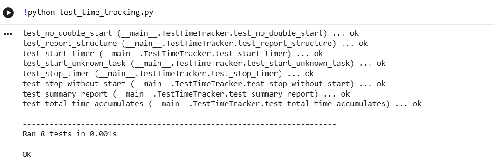

# Модуль учёта времени для системы управления задачами

Проект выполнен в рамках практического задания к лекции №5 «Этапы разработки программного продукта».

## Требования задания
- Возможность старта/остановки таймера для задачи
- Учёт общего затраченного времени
- Генерация отчётов по времени
- Интеграция с существующей системой задач
- Дополнительные функции:
  - Множественные сессии: возможность ставить задачу на паузу и возобновлять работу
  - Плановое время (Estimated Time): установка ожидаемого времени и расчёт отклонений
  - Экспорт отчётов: выгрузка аналитики в форматы JSON и CSV
  - Unit-тесты: полное покрытие основных методов

## Структура проекта
```text
task-time-tracker/
├── time_tracker.py       # отдельный модуль учёта времени
├── main.py               # общая система задач + интеграция
├── test_time_tracker.py  # unit-тесты
├── README.md             # документация
└── requirements.txt      # зависимости

1. Скриншот с запуском Unit-тестов


2. Скриншот с демонстрацией работы

